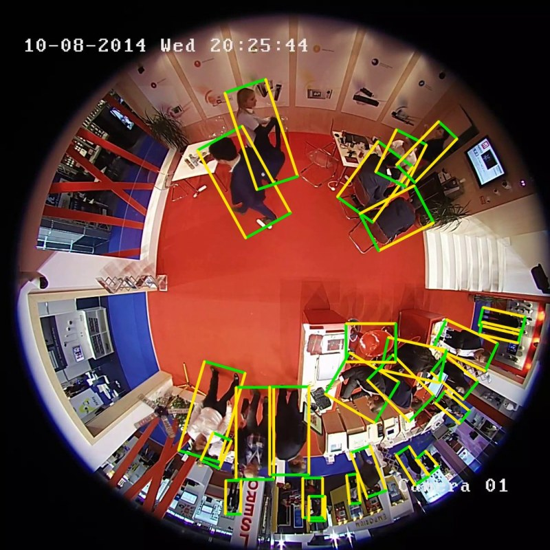
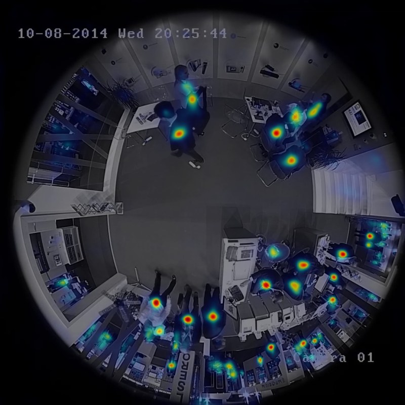

# Anchor-free Rotating People Detection in Fisheye Cameras

A PyTorch 2.x anchor-free detector for people in overhead fisheye images, with comparison against [RAPiD](https://github.com/duanzhiihao/RAPiD).

This is a CenterNet-style detector (DLA-34 + deformable DLA-Up decoder) that predicts a
rotated box per person as a heatmap peak plus offset, size and angle. It needs no anchors
and no NMS. Every hyperparameter is a config key that can be overridden from the command line.

<table align="center">
  <tr>
    <td align="center"></td>
    <td align="center"></td>
  </tr>
  <tr>
    <td align="center"><em>Detections: width edges in green, height edges in yellow</em></td>
    <td align="center"><em>Predicted person-centre heatmap (one peak per person)</em></td>
  </tr>
</table>
<p align="center"><em>WEPDTOF <code>exhibition_000039</code> at 1024 input, by the model fine-tuned on HABBOF + CEPDOF
(it never saw WEPDTOF in training). All 15 annotated people are found.</em></p>

## Results

All numbers come from one evaluator, [arpd/eval/rotated_eval.py](arpd/eval/rotated_eval.py):
rotated-box IoU, COCO-style AP averaged over the videos of each dataset, and P/R at a
confidence threshold of 0.3. RAPiD numbers come from the authors' public checkpoints
scored with the same code.

### COCO-pretrained models (no fisheye training)

Ours: final COCO checkpoint at 512 input. RAPiD: public
[COCO608 checkpoint](https://github.com/duanzhiihao/RAPiD/releases/download/v0.1/rapid_pL1_dark53_COCO608_Jan07_20000.ckpt)
at 608 input.

| Benchmark | Model | AP50 | AP | AP75 | P | R |
|---|---|---|---|---|---|---|
| COCO val2017, people | Ours | **66.5** | **39.8** | **39.5** | .644 | **.674** |
| | RAPiD | 62.1 | 29.8 | 24.5 | **.734** | .560 |
| COCO val, rotated ±180° | Ours | **64.7** | **37.3** | **36.9** | .620 | **.658** |
| | RAPiD | 59.8 | 28.0 | 22.7 | **.711** | .542 |
| HABBOF, zero-shot | Ours | 86.6 | 32.7 | 14.1 | .832 | **.848** |
| | RAPiD | **88.6** | **36.8** | **20.8** | **.918** | .760 |
| CEPDOF, zero-shot | Ours | **70.6** | 25.2 | 7.6 | .830 | **.603** |
| | RAPiD | 67.8 | **25.5** | **9.8** | **.906** | .496 |
| WEPDTOF, zero-shot | Ours | **49.2** | **17.2** | **5.4** | .778 | **.400** |
| | RAPiD | 42.9 | 15.0 | 4.4 | **.830** | .274 |

### Fisheye, leave-one-dataset-out

Each model is fine-tuned on two datasets and tested on the third.

| Method | Test set | Trained on | Input | Fine-tuning | AP50 | AP | AP75 |
|---|---|---|---|---|---|---|---|
| Ours | HABBOF | CEPDOF + WEPDTOF | 512 | 10 epochs | 94.6 | 52.8 | 52.1 |
| Ours | HABBOF | CEPDOF + WEPDTOF | 1024 | 10 epochs | 94.5 | 56.3 | 57.4 |
| RAPiD | HABBOF | — | — | — | — | — | — |
| Ours | CEPDOF | HABBOF + WEPDTOF | 512 | 10 epochs | 80.9 | 35.3 | 22.6 |
| Ours | CEPDOF | HABBOF + WEPDTOF | 1024 | 10 epochs | 83.3 | 38.9 | 26.7 |
| RAPiD | CEPDOF | — | — | — | — | — | — |
| RAPiD | WEPDTOF | HABBOF + CEPDOF | 608 | authors' checkpoint† | 53.0 | **22.8** | **14.9** |
| Ours | WEPDTOF | HABBOF + CEPDOF | 512 | 1 epoch | **56.7** | 22.6 | 11.0 |
| RAPiD | WEPDTOF | HABBOF + CEPDOF | 1024 | authors' checkpoint† | 70.5 | 32.8 | 23.8 |
| Ours | WEPDTOF | HABBOF + CEPDOF | 1024 | 10 epochs | **72.6** | **33.8** | **24.7** |

- Ours: AdamW, learning rate 1.25e-5, trained at 512 from the COCO checkpoint above.
- † RAPiD's public
  [HBCP608 checkpoint](https://github.com/duanzhiihao/RAPiD/releases/download/v0.1/pL1_HBCP608_Apr14_6000.ckpt):
  SGD, learning rate 1e-4, trained at 608, checkpoint chosen on HABBOF Lab1.
- RAPiD's public fisheye checkpoints were trained on HABBOF and CEPDOF, so it has no
  held-out result on those two datasets.
- Training videos follow RAPiD: HABBOF Lab1 and CEPDOF All_off / IRfilter are not used for
  training, but every video is used when a dataset is the test set.
- MW-R, the third dataset used by RAPiD, is not used: its frames come from the Mirror
  Worlds videos, whose download link is no longer accessible. WEPDTOF replaces it.

### Speed

Total time per image at batch size 1, from JPEG read to boxes in image coordinates
(preprocessing, network, and decoding: peak extraction for ours, rotated NMS for RAPiD),
fp32, measured on the same machine for both models on WEPDTOF `exhibition_000001.jpg`.
Absolute numbers depend on the hardware.

| Method | Input | exhibition (1080×1080) |
|---|---|---|
| RAPiD | 608 | 32.6 ms (30.7 FPS) |
| Ours | 512 | 19.8 ms (50.5 FPS) |
| RAPiD | 1024 | 51.3 ms (19.5 FPS) |
| Ours | 1024 | 39.7 ms (25.2 FPS) |

## Installation

```bash
python -m venv .venv && source .venv/bin/activate     # or conda, Python 3.11
pip install -r requirements.txt
python tests/test_core.py                              # geometry / target / loss / eval unit tests
```

No custom CUDA build is needed. For the RAPiD comparison, clone
[RAPiD](https://github.com/duanzhiihao/RAPiD) next to this repository and download the two
released checkpoints used here into `../RAPiD/weights/`:

| Checkpoint | Trained on | Used for |
|---|---|---|
| [rapid_pL1_dark53_COCO608_Jan07_20000.ckpt](https://github.com/duanzhiihao/RAPiD/releases/download/v0.1/rapid_pL1_dark53_COCO608_Jan07_20000.ckpt) | COCO | COCO-pretrained table |
| [pL1_HBCP608_Apr14_6000.ckpt](https://github.com/duanzhiihao/RAPiD/releases/download/v0.1/pL1_HBCP608_Apr14_6000.ckpt) | COCO, then HABBOF + CEPDOF | fisheye table, speed table |

```bash
git clone https://github.com/duanzhiihao/RAPiD ../RAPiD
wget -P ../RAPiD/weights \
  https://github.com/duanzhiihao/RAPiD/releases/download/v0.1/rapid_pL1_dark53_COCO608_Jan07_20000.ckpt \
  https://github.com/duanzhiihao/RAPiD/releases/download/v0.1/pL1_HBCP608_Apr14_6000.ckpt
```

## Pretrained checkpoints

The checkpoints are included in [`weights/`](weights) (cloning the repository downloads them,
about 400 MB in total). Each file holds the EMA weights and the config it was trained with.

| File | Size | Trained on | Results it gives |
|---|---|---|---|
| [`coco_pretrain_dla34_512.pth`](weights/coco_pretrain_dla34_512.pth) | 79.3 MB | COCO people (90 epochs) | COCO-pretrained table; starting point for fine-tuning |
| [`cv_test_HABBOF.pth`](weights/cv_test_HABBOF.pth) | 79.2 MB | COCO, then CEPDOF + WEPDTOF (10 epochs) | HABBOF rows |
| [`cv_test_CEPDOF.pth`](weights/cv_test_CEPDOF.pth) | 79.2 MB | COCO, then HABBOF + WEPDTOF (10 epochs) | CEPDOF rows |
| [`cv_test_WEPDTOF.pth`](weights/cv_test_WEPDTOF.pth) | 79.2 MB | COCO, then HABBOF + CEPDOF (10 epochs) | WEPDTOF 1024 row, speed table, demo image |
| [`cv_test_WEPDTOF_epoch1.pth`](weights/cv_test_WEPDTOF_epoch1.pth) | 79.3 MB | COCO, then HABBOF + CEPDOF (1 epoch) | WEPDTOF 512 row |

```bash
# detect people in your own fisheye images (--heatmap also saves demo_heatmap.jpg)
python tools/demo.py weights/cv_test_WEPDTOF.pth path/to/frame.jpg --input_size 1024 --out demo.jpg --heatmap
# score a checkpoint on its held-out dataset (writes metrics_in1024.json next to it)
python tools/evaluate.py weights/cv_test_WEPDTOF.pth --tag in1024 input_size=1024
# fine-tune from the released COCO checkpoint instead of pretraining yourself
python tools/train.py configs/cv_test_WEPDTOF.yaml train.init_from=weights/coco_pretrain_dla34_512.pth
```

The demo images above come from `python tools/demo.py weights/cv_test_WEPDTOF.pth
data/fisheye/WEPDTOF/exhibition/exhibition_000039.jpg --input_size 1024 --heatmap`.

## Data

Datasets are licensed for non-commercial research use by their owners.

* **COCO 2017** ([cocodataset.org](https://cocodataset.org)): `train2017/`, `val2017/` and
  `annotations/instances_{train,val}2017.json` under `data/coco/`.
* **HABBOF**, **CEPDOF**, **WEPDTOF**: request them from the
  [VIP lab at Boston University](https://vip.bu.edu/projects/vsns/cossy/datasets/).
* **MW-R** is not used. Its frames must be extracted from the Mirror Worlds videos, whose
  download link is no longer accessible, so WEPDTOF takes its place as the third dataset.

Build the layout the code expects (frames are symlinked, not copied):

```bash
python tools/prepare_data.py organize --dataset CEPDOF --ann_dir <CEPDOF>/annotations \
    --frames <CEPDOF> --root data/fisheye
python tools/prepare_data.py organize --dataset WEPDTOF --ann_dir <WEPDTOF>/annotations \
    --frames <WEPDTOF>/frames --roi_dir <WEPDTOF>/ROI_maps --root data/fisheye
python tools/prepare_data.py habbof --src <HABBOF> --root data/fisheye
python tools/prepare_data.py check --root data/fisheye

python tools/prepare_data.py coco_person --coco data/coco         # COCO val people -> rotated-box json
python tools/prepare_data.py monitor --coco data/coco --root data/fisheye   # pretraining monitor sets
python tools/make_rotated_val.py \
    --ann data/coco/annotations/person_val2017_rot.json --img_dir data/coco/val2017 \
    --out_img data/coco/val2017_rot180_s0 --out_ann data/coco/annotations/person_val2017_rot180_s0.json
```

The rotated COCO val set rotates each image by an angle drawn uniformly from ±180°
(seeded per image) onto an enlarged canvas, so no person is cropped and labels stay exact.

## Reproducing the results

Every command runs from the repository root. [scripts/reproduce.sh](scripts/reproduce.sh)
runs the same steps (`bash scripts/reproduce.sh <step>`). Each evaluation writes
`metrics_<tag>.json` next to the checkpoint; the numbers in the tables are its `mean` entry
(average over videos). Training is not bit-for-bit deterministic, so expect run-to-run
differences of about ±1 AP50.

**1. COCO pretraining** (90 epochs, global batch 64):

```bash
torchrun --nproc_per_node=2 tools/train.py configs/coco_pretrain.yaml
# -> runs/coco_pretrain_dla34_512/final.pth
```

**2. COCO-pretrained table**:

```bash
P=runs/coco_pretrain_dla34_512/final.pth
python tools/evaluate.py $P --tag coco_val \
  "data.test=[{type: json, name: coco_val, img_dir: data/coco/val2017, ann: data/coco/annotations/person_val2017_rot.json}]"
python tools/evaluate.py $P --tag coco_val_rot180 \
  "data.test=[{type: json, name: coco_val_rot180, img_dir: data/coco/val2017_rot180_s0, ann: data/coco/annotations/person_val2017_rot180_s0.json}]"
for D in HABBOF CEPDOF WEPDTOF; do
  python tools/evaluate.py $P --tag zeroshot_$D "data.test=[{type: fisheye, dataset: $D}]"
done
# RAPiD COCO608 at 608 -> runs/rapid_baseline/metrics_COCO608_<set>.json
python tools/eval_rapid.py ../RAPiD/weights/rapid_pL1_dark53_COCO608_Jan07_20000.ckpt --tag COCO608 \
  --json coco_val:data/coco/val2017:data/coco/annotations/person_val2017_rot.json \
         coco_val_rot180:data/coco/val2017_rot180_s0:data/coco/annotations/person_val2017_rot180_s0.json \
  --datasets HABBOF CEPDOF WEPDTOF
```

**3. Fisheye fine-tuning** (10 epochs, learning rate 1.25e-5, checkpoints after epochs 1 and 10):

```bash
for T in HABBOF CEPDOF WEPDTOF; do
  python tools/train.py configs/cv_test_$T.yaml      # -> runs/cv_test_$T/{epoch1,final}.pth
done
```

Training ends with an evaluation of the final checkpoint at 512 (`metrics_final.json`).

**4. Fisheye table**:

```bash
for T in HABBOF CEPDOF WEPDTOF; do
  python tools/evaluate.py runs/cv_test_$T/final.pth --tag in1024 input_size=1024
done
python tools/evaluate.py runs/cv_test_WEPDTOF/epoch1.pth --tag ep1     # WEPDTOF, 512, 1 epoch
# HABBOF / CEPDOF at 512: runs/cv_test_{HABBOF,CEPDOF}/metrics_final.json
for S in 608 1024; do   # RAPiD HBCP608 on WEPDTOF
  python tools/eval_rapid.py ../RAPiD/weights/pL1_HBCP608_Apr14_6000.ckpt \
    --datasets WEPDTOF --input_size $S --tag HBCP608_in$S
done
```

**5. Speed** (read the `e2e ms` column):

```bash
python tools/benchmark.py --ckpt runs/cv_test_WEPDTOF/final.pth --sizes 512 608 1024 --dtype fp32 \
  --image data/fisheye/WEPDTOF/exhibition/exhibition_000001.jpg \
  --rapid ../RAPiD --rapid_ckpt ../RAPiD/weights/pL1_HBCP608_Apr14_6000.ckpt
```

### Optional: epoch selection for the 512 WEPDTOF row

The 1-epoch setting was chosen without scoring a video on itself. Five fine-tuning
variants were trained with a checkpoint after every epoch, giving 50 candidates scored at
512 on WEPDTOF. The 16 videos are split into two halves (sorted names, alternating), the
best candidate by AP50 on one half is scored on the other, and the two halves are swapped.
Both halves pick learning rate 1.25e-5 after epoch 1.

```bash
E="train.save_epochs=[1,2,3,4,5,6,7,8,9,10]"
for LR in 1.25e-4 3.75e-5 1.25e-5; do
  python tools/train.py configs/cv_test_WEPDTOF.yaml name=cv_WEPDTOF_lr$LR train.lr=$LR $E
done
for LR in 1.25e-4 3.75e-5; do
  python tools/train.py configs/cv_test_WEPDTOF.yaml name=cv_WEPDTOF_sc03_lr$LR train.lr=$LR $E \
    "augment.scale_range=[0.3,1.4]"
done
for C in runs/cv_WEPDTOF_*/epoch*.pth; do
  N=$(basename $C .pth); python tools/evaluate.py $C --tag ep${N#epoch}
done
python tools/select_2fold.py runs/cv_WEPDTOF_*/metrics_ep*.json
```

## Code layout

```
arpd/
  boxes.py              rotated-box geometry (CEPDOF convention: cx, cy, w, h, degrees; clockwise)
  data/transforms.py    one affine warp per sample: letterbox, scale, rotation, flips, shift (+ colour)
  data/targets.py       CenterNet heatmap / offset / size / angle targets
  data/datasets.py      COCO-person and fisheye (CEPDOF-format) sources
  models/neck.py        DLA-Up / IDA-Up decoder with modulated deformable convolution
  models/arpd.py        timm backbone (DLA-34) + heads (heatmap, offset, size, angle)
  losses.py             focal loss, L1, periodic smooth-L1 angle loss
  decode.py             max-pool peak extraction -> rotated boxes (no NMS)
  eval/rotated_eval.py  rotated IoU via RLE masks, COCO AP, P / R / F1
  engine.py             DDP, EMA, LR schedule, batched inference
configs/
  base.yaml             all defaults; any key can be overridden as key.sub=value
  coco_pretrain.yaml    stage 1: COCO people with random rotation
  cv_test_<D>.yaml      stage 2: fine-tune on the other two datasets, test on <D>
tools/
  train.py  evaluate.py  demo.py  eval_rapid.py  benchmark.py  prepare_data.py
  make_rotated_val.py  select_2fold.py  visualize.py
weights/                released checkpoints
scripts/reproduce.sh    the commands above, step by step
tests/test_core.py      unit tests
```

## License

The code is released under the [MIT License](LICENSE). The datasets and RAPiD's weights
keep their own licenses.

## Acknowledgements

The decoder follows [CenterNet](https://github.com/xingyizhou/CenterNet); the
fisheye protocol, training-video choices and baseline come from
[RAPiD](https://github.com/duanzhiihao/RAPiD); HABBOF, CEPDOF and WEPDTOF are from the
VIP lab at Boston University.
